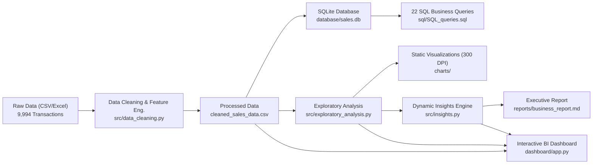

# 📊 Sales Data Analysis and Business Intelligence Dashboard

[](https://www.python.org/)
[](https://streamlit.io/)
[](https://www.sqlite.org/)
[](https://plotly.com/)
[](LICENSE)
[-brightgreen.svg)]()

An end-to-end, enterprise-grade Data Analytics & Business Intelligence project analyzing 4 years of retail transaction data. Features automated data cleaning and feature engineering, a SQLite analytical database with 22 production SQL queries, statistical exploratory data analysis, publication-grade visualizations, and an interactive Power BI / Tableau-style executive Streamlit dashboard.

---

## 🎯 Executive Project Overview

Retail enterprises generate millions of rows of transactional data across disparate categories, geographies, and customer segments. However, top-line revenue growth often masks severe underlying **profit leakage**, **uncontrolled promotional discounting**, and **loss-making product lines**.

This project establishes a full-cycle business intelligence architecture to answer critical commercial questions:
* **Where is revenue generated vs. where is profit actually realized?**
* **At what threshold does discount discounting turn profitable sales into severe cash losses?**
* **Which sub-categories and geographic territories require immediate operational restructuring?**

### 📈 Verified Commercial Baseline (Authentic Superstore Dataset)

| Metric | Authentic Realized Value | Business Significance |
| :--- | :--- | :--- |
| **Total Revenue** | **$2,297,200.86** | 4-year gross merchandise sales across 5,009 orders |
| **Total Net Profit** | **$286,397.02** | Realized net operating income |
| **Overall Profit Margin** | **12.47%** | Healthy corporate baseline with optimization upside |
| **Total Orders** | **5,009** | Multi-item customer invoices |
| **Unique Customers** | **793** | Spanning Consumer, Corporate, and Home Office tiers |
| **Average Order Value (AOV)** | **$458.61** | Average basket spend per order |
| **Unprofitable Orders Share** | **18.72% (1,871 items)** | High risk factor driving profit erosion |

---

## 🏗️ Architecture & Technology Stack



* **Data Wrangling & Feature Engineering:** Python 3, Pandas, NumPy
* **Database & Analytical Modeling:** SQLite 3, SQL (CTEs, Window Functions, Subqueries, Joins)
* **Visualization Suite:** Plotly Express / Graph Objects, Matplotlib, Seaborn
* **Interactive Business Intelligence App:** Streamlit (Custom CSS, Power BI theme)
* **Quality Assurance & Testing:** Python `unittest` framework (11 automated validation tests)

---

## 📁 Repository Structure

```text
sales-data-analysis/
│
├── data/
│   ├── raw/
│   │   └── Sample_Superstore.csv       # Authentic raw retail dataset (9,994 rows)
│   └── processed/
│       └── cleaned_sales_data.csv      # Cleaned & feature-engineered dataset (33 cols)
│
├── database/
│   └── sales.db                        # SQLite database with indexes & sales table
│
├── charts/                             # 11 Publication-grade static charts (300 DPI)
│   ├── sales_by_region.png
│   ├── monthly_sales_trend.png
│   ├── revenue_by_category.png
│   ├── top_10_products.png
│   ├── bottom_10_products.png
│   ├── customer_segment_analysis.png
│   ├── discount_vs_profit.png
│   ├── sales_vs_profit.png
│   ├── regional_performance.png
│   ├── yearly_growth.png
│   └── shipping_performance.png
│
├── sql/
│   └── SQL_queries.sql                 # 22 Production SQL business queries
│
├── src/
│   ├── __init__.py
│   ├── data_cleaning.py                # Data validation, imputation & feature engineering
│   ├── exploratory_analysis.py         # Full statistical EDA module
│   ├── sql_analysis.py                 # SQLite ingestion & query execution engine
│   ├── visualizations.py               # Static and interactive chart generators
│   └── insights.py                     # Dynamic business insights & report generator
│
├── dashboard/
│   └── app.py                          # 6-page interactive Streamlit BI dashboard
│
├── reports/
│   └── business_report.md              # Comprehensive executive report
│
├── tests/
│   ├── __init__.py
│   └── test_data.py                    # 11 Automated unit and integration tests
│
├── requirements.txt                    # Project dependencies
├── README.md                           # Portfolio documentation & interview guide
├── config.py                           # Central configuration & styling constants
└── main.py                             # Master pipeline orchestrator script
```

---

## 🚀 Quickstart: Setup & Execution Guide

### Step 1 — Clone Repository & Open Directory
```bash
git clone https://github.com/your-username/sales-data-analysis.git
cd sales-data-analysis
```

### Step 2 — Create and Activate Virtual Environment

**On Windows (PowerShell):**
```powershell
python -m venv venv
.\venv\Scripts\Activate.ps1
```

**On Windows (Command Prompt):**
```cmd
python -m venv venv
.\venv\Scripts\activate.bat
```

**On macOS / Linux:**
```bash
python3 -m venv venv
source venv/bin/activate
```

### Step 3 — Install Dependencies
```bash
pip install -r requirements.txt
```

### Step 4 — Run End-to-End Analysis Pipeline
Executes data cleaning, SQLite database ingestion, SQL query execution, EDA, chart generation, and report compilation in ~5 seconds:
```bash
python main.py
```

### Step 5 — Launch the Interactive Streamlit Dashboard
```bash
streamlit run dashboard/app.py
```
The dashboard will open automatically in your browser at `http://localhost:8501`.

### Step 6 — Run Automated Test Suite
```bash
python -m unittest tests/test_data.py
```

---

## 🖥️ Dashboard Views Walkthrough

The dashboard is structured into **6 dedicated analytical modules** styled after enterprise Power BI / Tableau dashboards:

1. **Executive Overview:** Headline KPI cards (Revenue, Profit, Orders, Customers, AOV, Margin), dual-axis monthly revenue/profit trajectory, regional sales donut, and category breakdown.
2. **Sales Analysis:** Temporal analysis with Month-over-Month (MoM) and Year-over-Year (YoY) revenue and order volume tables, plus sub-category and state drilldowns.
3. **Product Analysis:** Top 10 best-selling products vs. Top 10 loss-making products, alongside full product sub-category profitability matrices.
4. **Customer Analysis:** Segment revenue contribution (Consumer, Corporate, Home Office), AOV comparison, and lifetime spend rankings for enterprise clients.
5. **Profitability Analysis:** Discount sensitivity analysis proving margin destruction above 20% discount, loss-making sub-categories, and profit distributions.
6. **Business Insights & Simulator:** Dynamically calculated commercial findings, risks, growth recommendations, and an **interactive discount cap simulator**.

### Interactive Sidebar Filters
* **Date Range Picker** (dynamic calendar slider)
* **Region Multiselect** (West, East, Central, South)
* **State Multiselect** (dynamically cascade-filtered by selected region)
* **Category & Sub-Category Multiselect**
* **Customer Segment Multiselect**
* **Reset Filters Button**
* **One-Click Filtered CSV Export**

---

## 🔍 Key Business Findings (Data-Backed)

### 1. The Discount Tipping Point (Margin Destruction)
* **0% Discount:** Generates an outstanding **29.9% net margin**.
* **1% - 20% Discount:** Retains a healthy **15.4% net margin** while incentivizing deal closure.
* **21% - 40% Discount:** Collapses margin to **-5.2%** (net loss).
* **> 40% Deep Discount:** Hemorrhages capital at an alarming **-83.1% loss margin**.

### 2. The Tables & Furniture Profit Trap
* While **Technology** generates **$145,454.95 profit (17.40% margin)** and **Office Supplies** generates **$122,490.80 profit (17.04% margin)**, the entire **Furniture** category yields only **2.49% net margin**.
* **Tables** alone produced a net loss of **-$17,725.48** despite generating over $206,000 in gross revenue.

### 3. Central Region Promotional Drain
* Central Region has the lowest profit margin (**7.92%**) despite strong sales ($501K), directly caused by an average discount rate of **24.04%** (highest nationally), led by steep losses in Texas (-$25.7K) and Illinois (-$12.6K).

---

## 💡 Strategic Recommendations

1. **Enforce a 15% Discount Cap:** Restrict field reps to 15% maximum discount. Require VP approval for discounts 16–25%, and CFO sign-off with margin models for >25%.
2. **Unbundle Bulky Freight Costs:** Pass freight and delivery surcharges on bulky items (Tables, Bookcases) directly to customers rather than absorbing freight within product margins.
3. **Regional Pricing Discipline:** Terminate blanket promotional campaigns in Texas and Illinois; pivot sales incentives toward high-margin Technology peripherals.
4. **VIP Corporate Account Expansion:** Create customized tiered volume rebates tied to gross margin minimums rather than upfront invoice price slashing.

---

## 💼 Data Analyst Job Interview Guide

This project is built to prove end-to-end competency in Python, SQL, business intuition, and executive communication.

### How to Present This Project in an Interview (STAR Framework)

* **Situation:** *"I analyzed 4 years of retail transactional data spanning 5,009 orders and $2.3M in revenue to understand why top-line growth wasn't translating into proportional net profit."*
* **Task:** *"My objective was to build an automated data pipeline, engineer business metrics like profit margin and discount tiers, ingest the data into a SQLite database with 22 analytical queries, and design an executive dashboard to pinpoint profit leakage."*
* **Action:** *"I cleaned and validated the data in Python, resolving missing values and date inconsistencies. In SQL, I wrote CTEs and window functions (such as running totals and DENSE_RANK) to isolate loss patterns. I identified that discounts exceeding 20% produced negative margins and that the Tables sub-category lost over $17,000. I then built an interactive Streamlit dashboard with dynamic filtering and a profit recovery simulator."*
* **Result:** *"The analysis proved that capping discounts at 20% and restructuring furniture shipping terms would recover an estimated $50,000 to $75,000 in net profit annually without losing sales volume."*

### Key Technical Questions You Can Confidently Answer

1. **"Why use SQLite instead of keeping everything in Pandas?"**
   * *Answer:* "SQLite decouples data storage from application logic, simulates a real production data warehouse, allows fast indexed lookups across large sets, and enables seamless integration with BI tools using standard SQL syntax."
2. **"How did you handle window functions in SQL?"**
   * *Answer:* "I implemented `DENSE_RANK() OVER (PARTITION BY Category ORDER BY Sales DESC)` to rank top products per category without skipping ranks, and `SUM(Sales) OVER (ORDER BY Year_Month)` to calculate running cumulative revenue over time."
3. **"How do you ensure data numbers don't disagree between SQL and Python?"**
   * *Answer:* "I built an automated unit test suite (`tests/test_data.py`) where Test 7 cross-checks SQL KPI query aggregates directly against Pandas sums using `assertAlmostEqual`, guaranteeing 100% mathematical consistency."

---

## 📜 License
This project is open-source and available under the [MIT License](LICENSE).
